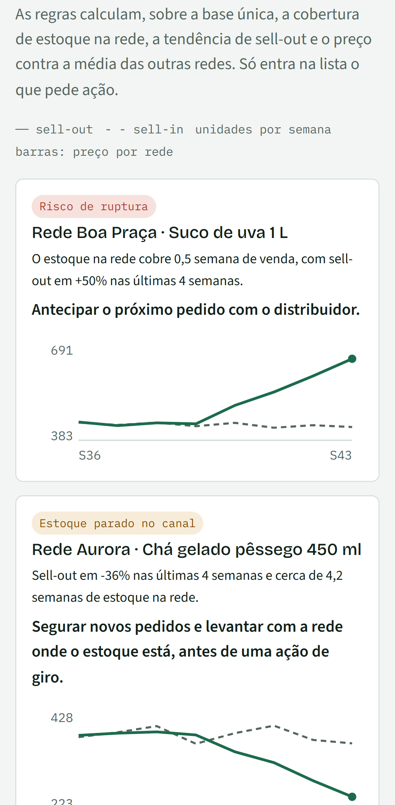
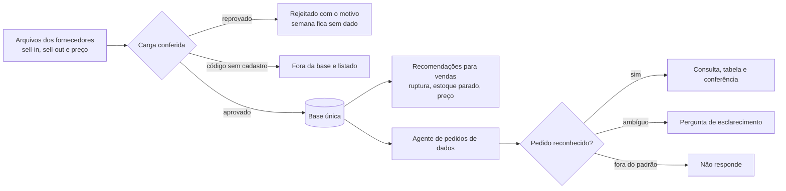
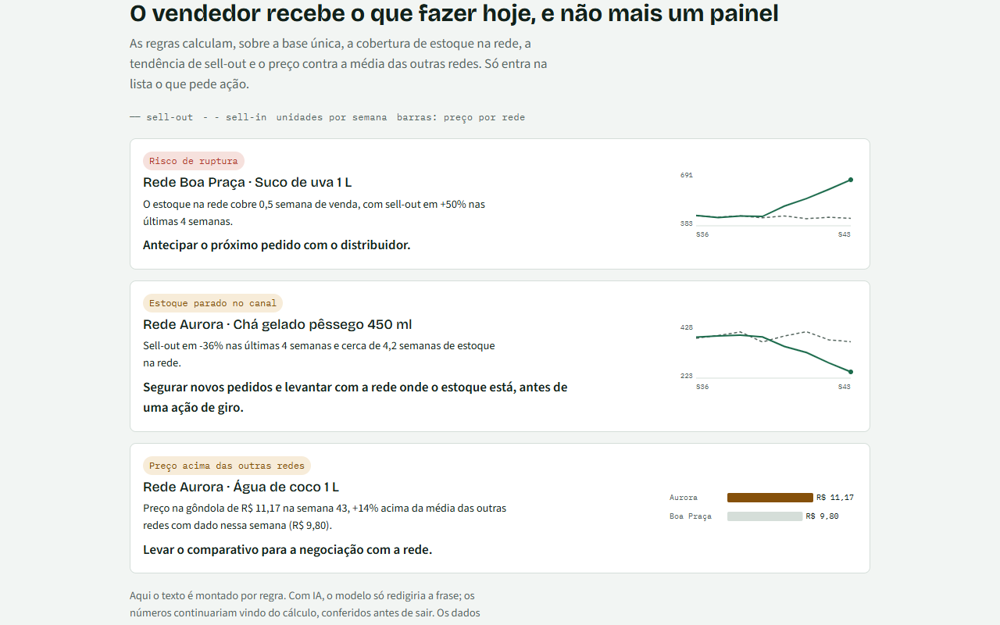
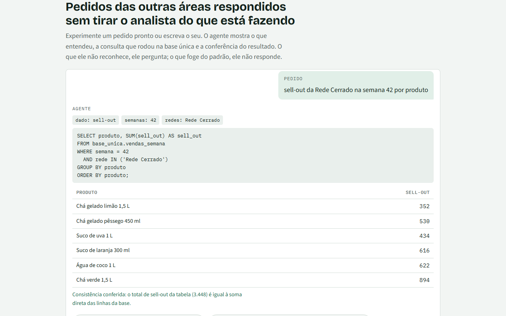

# Teia de Dados Comercial

Prova de conceito com **dados fictícios**: arquivos de sell-in (o que a indústria vende para a
rede) e sell-out (o que a rede vende ao consumidor) chegam dos fornecedores, passam por uma carga
conferida e viram uma base única. Dessa base saem recomendações para vendas e as respostas de um
agente de pedidos de dados.

**Abrir a demonstração:** https://diaquinodev.github.io/teia-de-dados/ (sem login, sem instalar nada)

| Computador | Celular |
|---|---|
|  |  |

## O problema

Em áreas comerciais, boa parte do tempo vai para juntar arquivos de fontes diferentes, conferir
se os números batem e responder pedidos repetidos. O risco não é só a demora: uma semana sem
arquivo tratada como venda zero vira uma decisão errada. Esta demonstração mostra como eu
começaria a atacar isso, em pequena escala, antes de desenhar a solução real com o time.

## Como funciona







## Decisões

- **"Sem dado" nunca vira zero.** Falta de arquivo aparece como falta, com o motivo.
- **Regras antes de IA.** Recomendações e agente são regras explícitas: dá para auditar por que
  cada resposta saiu. Um modelo de linguagem só entraria onde houvesse necessidade real de
  interpretar texto livre, atrás de um servidor que proteja a chave e limite o custo.
- **Página estática.** Sem servidor e sem chave, não há segredo para vazar nem custo para controlar.
  De fora, a página só carrega as fontes do texto (Google Fonts).

## Limitações

- Dados, redes e produtos são fictícios e gerados no navegador; não há integração com sistemas reais.
- Não há banco de dados nem modelo de linguagem: o agente reconhece um vocabulário fechado e o
  SQL exibido explica a consulta, que é calculada em JavaScript.
- Avisos a fornecedores e pedidos de cadastro são descritos na tela, não enviados.
- Volumes, limites das regras e o cálculo de tempo são exemplos, a validar com quem faz o processo.

## Organização

- `docs/index.html` — a página. As regras ficam no bloco `<teia-logica>`, em funções puras
  (`carregar`, `recomendar`, `interpretar`, `consultar`), sem acesso à tela.
- `testes/regras.test.cjs` — regras com casos escritos à mão, inclusive os limites (100 testes).
- `testes/mutantes.cjs` — planta 33 erros de regra, um por vez, e exige que os testes falhem (33 de 33 pegos).
- `testes/tela.cjs` — abre o arquivo publicado em 10 aparelhos (Chrome, Edge, Firefox,
  Safari/WebKit; computador, iPhone, iPad, Android), em tema claro e escuro: números conferidos
  contra os arquivos brutos, segurança e acessibilidade (axe).
- `testes/prints.cjs` — gera os prints deste README.

## Rodar

```
npm install
npm test
```

`test:tela` usa o Chrome e o Edge instalados no Windows e o Firefox e o WebKit do Playwright
(`npx playwright-core install firefox webkit`).

Para rodar os testes de tela contra o site no ar: `TEIA_URL=https://diaquinodev.github.io/teia-de-dados/ npm run test:tela`.

## Regras

1. Semana sem arquivo válido = "sem dado", nunca zero.
2. Reenvio: o arquivo mais recente da rede e semana substitui o anterior inteiro; dois com a
   mesma hora e conteúdo diferente deixam a semana sem dado.
3. Na entrada, o arquivo é rejeitado inteiro (com o motivo) se: rede ou semana fora do cadastro,
   unidade que não seja inteiro ≥ 0, preço que não seja positivo, soma das linhas diferente do
   total declarado, produto repetido ou produto esperado ausente (uma linha por produto, todos
   os produtos do cadastro; vale para sell-in e sell-out). Linha ausente pode ser venda zero ou
   falha de extração: sem o fornecedor dizer qual, o arquivo não entra.
4. Código sem de-para fica fora da base e é listado.
5. Totais de sell-out e de sell-in conferidos pelo cabeçalho dos arquivos, menos o que ficou
   sem cadastro. Se não bater, a carga fica bloqueada; se bater com lacunas, fica "parcial".
6. Estoque = anterior + sell-in − sell-out; deixa de existir depois de uma lacuna.
7. Ruptura: cobertura abaixo de 1 semana (média das 2 últimas semanas com dado).
8. Estoque parado: cobertura acima de 3 semanas e queda maior que 10% contra 4 semanas antes,
   ou estoque sem venda nas 2 últimas semanas.
9. Preço: só redes com dado na mesma semana; mais de 10% acima da média das outras.
10. Recomendação de uma semana olha só a base até ela. O que não dá para avaliar (estoque
    desconhecido, menos de 2 semanas) aparece com o motivo: "sem alerta" nunca esconde "sem dado".
11. Agente: só aceita palavras e nomes que conhece; entende semana, lista e intervalo de semanas;
    "vendas" pede esclarecimento; preço sai por produto; pedidos financeiros, pessoais ou de
    concorrência não são respondidos. A conferência da tabela é de consistência (cálculo contra
    tabela), não uma fonte independente.
