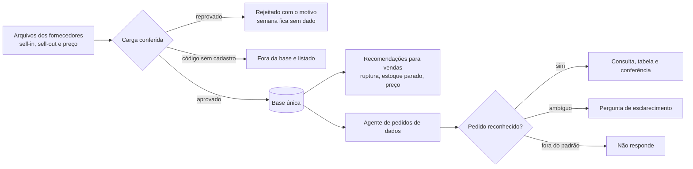
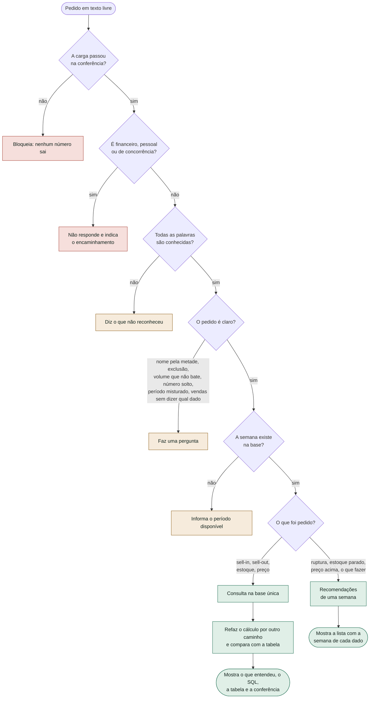
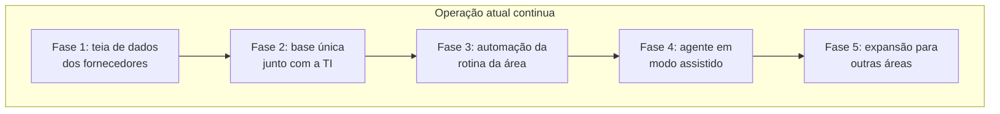
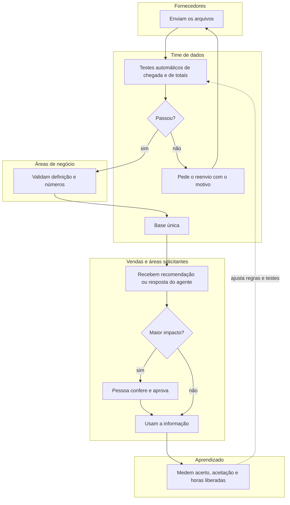

# Teia de Dados Comercial

Case de estudo com **dados fictícios**: arquivos de sell-in (o que a rede compra, pelo
distribuidor) e sell-out (o que a rede vende ao consumidor) chegam dos fornecedores, passam por uma carga
conferida e viram uma base única. Dessa base saem recomendações para vendas e as respostas de um
agente de pedidos de dados. Semana sem arquivo aparece como falta, nunca como zero.

**Abrir a demonstração:** https://diaquinodev.github.io/teia-de-dados/ (sem login, sem instalar nada)

| Computador | Celular |
|---|---|
|  |  |

## O problema

Times comerciais recebem, toda semana, arquivos heterogêneos de sell-in e sell-out. Boa parte do
tempo vai para juntar essas fontes, conferir se os números batem e responder pedidos repetidos. O
risco não é só a demora: uma semana sem arquivo tratada como venda zero vira uma decisão errada.
Este case mostra, em pequena escala, uma forma de atacar isso antes de desenhar a operação real
com o time.

## Como funciona




## A lógica do agente

O agente responde pedidos de dados de outras áreas, como "sell-out da Rede Aurora na semana 42".
Nesta demonstração ele funciona só com regras, sem modelo de linguagem. A regra central é:
**o agente nunca amplia nem troca o pedido. O que não entende, ele pergunta.** Uma resposta errada
com cara de certa custa mais caro que uma pergunta a mais.



Verde: responde. Laranja: pergunta ou explica. Vermelho: não responde.

| Pedido | O que o agente faz | Por quê |
|---|---|---|
| `sell-out da Rede Aurora na semana 42` | Responde por produto | Dado, rede e semana estão claros |
| `sell-out de suco` | Filtra os dois sucos | "Suco" é uma família de produtos |
| `sell-out do suco de uva` | Filtra só a uva | O nome específico vence a família |
| `sell-out da 40 até a 42` | Responde as semanas 40, 41 e 42 | Intervalo reconhecido |
| `vendas da Rede Aurora` | Pergunta: sell-in, sell-out, estoque ou preço? | "Vendas" pode ser mais de um dado |
| `sell-out da aurora 42` | Pergunta o que é o 42 | Não assume que é uma semana |
| `sell-out da boa` | Pergunta qual rede | Metade de um nome não escolhe rede |
| `sell-out sem a aurora` | Avisa que não faz exclusões | Filtrar a Aurora seria o contrário do pedido |
| `sell-out de Fanta` | Diz que não reconhece "fanta" | Produto fora da base |
| `sell-out de 40 a 41 e 43` | Pede para escrever só intervalo ou só lista | Não inclui a semana 42 sem ter sido pedida |
| `sell-out da semana 99` | Informa as semanas disponíveis | Não troca por outra semana |
| `qual a margem da Rede Aurora` | Não responde | Dado financeiro está fora do escopo |

**Por que regras, e não um modelo de linguagem, nesta etapa:** cada resposta pode ser auditada e
testada, sem custo por pedido nem chave para proteger. O preço é entender só um vocabulário fechado:
uma frase com palavra nova recebe uma recusa, mesmo quando uma pessoa entenderia.

## Da demonstração à operação real

Os desenhos abaixo são **hipótese para validar com o time, não um processo já confirmado**. Quem
aprova o quê depende de como a área funciona. O desenho seria feito junto com as pessoas, antes de
escolher ferramentas.

**A evolução em fases.** Consultas e reports continuam funcionando durante toda a mudança:



**O caminho do dado, com os responsáveis propostos:**



**O que precisa ser validado em cada etapa:**

| Etapa | Quem valida (a confirmar) | Evidência | Se falhar |
|---|---|---|---|
| Chegada dos arquivos | Time de dados | Arquivo esperado recebido e soma igual ao total declarado | Rejeita o arquivo, mostra o motivo e pede o reenvio |
| De-para de produtos | Time de dados | Todo código ligado a um cadastro | Fica fora da base, listado, com pedido de cadastro |
| Indicadores | Área dona do indicador | Definição escrita e total conferido | O indicador não é publicado |
| Recomendação | Vendas | Regra e números visíveis em cada alerta | Registra a recusa e ajusta a regra |
| Agente | Pessoa responsável pela área solicitante | Consulta, tabela e conferência à vista | Pergunta, ou encaminha para uma pessoa |

A demonstração cobre, em pequena escala, a carga conferida, a base única, as recomendações e o
agente. Validação pelas áreas, aprovação humana e medição ficam para a operação real.

## Decisões

- **"Sem dado" nunca vira zero.** Falta de arquivo aparece como falta, com o motivo.
- **Regras antes de IA.** Recomendações e agente são regras explícitas: dá para auditar por que
  cada resposta saiu. Um modelo de linguagem só entraria onde houvesse necessidade real de
  interpretar texto livre, atrás de um servidor que proteja a chave e limite o custo.
- **Página estática.** Sem servidor e sem chave, não há segredo para vazar nem custo para controlar.
  De fora, a página só carrega as fontes do texto (Google Fonts).

## Limitações

- Dados, redes e produtos são fictícios e gerados no navegador; não há integração com sistemas reais.
- Não há banco de dados nem modelo de linguagem: o agente reconhece um vocabulário fechado e o
  SQL exibido explica a consulta, que é calculada em JavaScript.
- Avisos a fornecedores e pedidos de cadastro são descritos na tela, não enviados.
- Volumes, limites das regras e o cálculo de tempo são exemplos, a validar com quem faz o processo.

## Organização

- `docs/index.html` — a página. As regras ficam no bloco `<teia-logica>`, em funções puras
  (`carregar`, `recomendar`, `interpretar`, `consultar`), sem acesso à tela.
- `testes/regras.test.cjs` — regras com casos escritos à mão, inclusive os limites (130 testes).
- `testes/mutantes.cjs` — planta 45 erros de regra, um por vez, e exige que os testes falhem (45 de 45 pegos).
- `testes/tela.cjs` — abre o arquivo publicado em 10 aparelhos (Chrome, Edge, Firefox,
  Safari/WebKit; computador, iPhone, iPad, Android), em tema claro e escuro: números conferidos
  contra os arquivos brutos, segurança e acessibilidade (axe).
- `testes/prints.cjs` — gera os prints deste README.

## Rodar

```
npm install
npm test
```

`test:tela` usa o Chrome e o Edge instalados no Windows e o Firefox e o WebKit do Playwright
(`npx playwright-core install firefox webkit`).

Para rodar os testes de tela contra o site no ar, no Git Bash: `TEIA_URL=https://diaquinodev.github.io/teia-de-dados/ npm run test:tela`.

## Regras

1. Semana sem arquivo válido = "sem dado", nunca zero.
2. Reenvio: o arquivo mais recente da rede e semana substitui o anterior inteiro; dois com a
   mesma hora e conteúdo diferente deixam a semana sem dado.
3. Na entrada, o arquivo é rejeitado inteiro (com o motivo) se: rede ou semana fora do cadastro,
   unidade que não seja inteiro ≥ 0, preço que não seja positivo, soma das linhas diferente do
   total declarado, produto repetido ou produto esperado ausente (uma linha por produto, todos
   os produtos do cadastro; vale para sell-in e sell-out). Linha ausente pode ser venda zero ou
   falha de extração: sem o fornecedor dizer qual, o arquivo não entra.
4. Código sem de-para fica fora da base e é listado.
5. Totais de sell-out e de sell-in conferidos pelo cabeçalho dos arquivos, menos o que ficou
   sem cadastro. Se não bater, a carga fica bloqueada; se bater com lacunas, fica "parcial".
6. Estoque = anterior + sell-in − sell-out; deixa de existir depois de uma lacuna. Se a conta der
   negativo, vira "sem dado", aparece na conferência e a carga fica "parcial".
7. Ruptura: cobertura abaixo de 1 semana (média das 2 últimas semanas com dado).
8. Estoque parado: cobertura acima de 3 semanas e queda maior que 10% contra 4 semanas antes,
   ou estoque sem venda nas 2 últimas semanas.
9. Preço: só redes com dado na mesma semana; mais de 10% acima da média das outras.
10. Recomendação de uma semana olha só a base até ela. O que não dá para avaliar (estoque
    desconhecido, menos de 2 semanas) aparece com o motivo: "sem alerta" nunca esconde "sem dado".
11. Agente: só aceita palavras e nomes que conhece e nunca amplia nem troca o pedido. Entende semana,
    lista e intervalo ("semanas 40 a 42", "da 40 até a 42"), família de produtos ("suco") e volume
    junto de um produto. Pergunta quando recebe "vendas", número solto, nome de rede pela metade,
    exclusão, volume que não combina ou período que mistura intervalo e lista. Preço sai por produto. Pedidos financeiros, pessoais ou de
    concorrência não são respondidos. A conferência da tabela é de consistência (cálculo contra
    tabela), não uma fonte independente.
